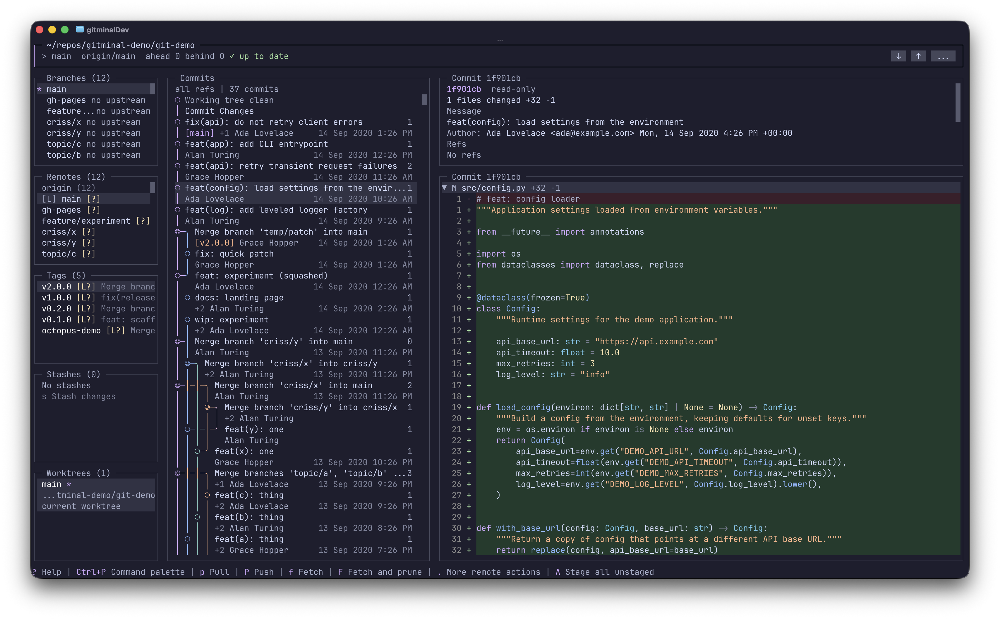

# Gitminal

A keyboard-first terminal git client with full mouse support.



Requires [Bun](https://bun.sh/) 1.3.14 or later. Gitminal runs on Bun, so Bun must be installed even when the package is installed through npm.

## Install

```bash
bunx @im4all/gitminal          # run without installing
bun add -g @im4all/gitminal    # install the `gitminal` command globally
npm install -g @im4all/gitminal
```

Then run `gitminal` inside any git repository.

## Terminal colors

If Gitminal looks monochrome, check the terminal environment. A non-empty `NO_COLOR` disables colors, while `COLORTERM=truecolor` enables full 24-bit color. Windows Terminal supports truecolor, but a WSL shell may not advertise it automatically.

### WSL, Linux, and macOS

Run this inside your shell (inside WSL when using Windows Terminal with WSL):

```bash
env -u NO_COLOR COLORTERM=truecolor gitminal
```

For a source checkout, use:

```bash
env -u NO_COLOR COLORTERM=truecolor bun preview
```

If that fixes the colors, add the following to `~/.bashrc` for Bash or `~/.zshrc` for Zsh, then open a new terminal:

```bash
unset NO_COLOR
export COLORTERM=truecolor
```

This enables colors for other apps too, so only unset `NO_COLOR` permanently if you do not intentionally use it. To inspect your current settings:

```bash
printf 'TERM=%s\nCOLORTERM=%s\nNO_COLOR=%s\n' "$TERM" "$COLORTERM" "$NO_COLOR"
```

On terminals without truecolor support, use their actual capabilities instead. `TERM=xterm-256color` selects Gitminal's 256-color fallback; do not override `TERM` globally unless it correctly describes your terminal.

### Native Windows PowerShell

Use Windows Terminal and set the environment in PowerShell before launching Gitminal:

```powershell
Remove-Item Env:NO_COLOR -ErrorAction SilentlyContinue
$env:COLORTERM = 'truecolor'
gitminal
```

Replace `gitminal` with `bun preview` when running a source checkout. These settings last for the current PowerShell session; add the first two lines to your PowerShell profile (`$PROFILE`) if you want them applied to future sessions. If you are running WSL from PowerShell, use the WSL instructions inside the Linux shell instead.

Gitminal's theme detection reads `NO_COLOR`, `COLORTERM`, and `TERM`; setting `FORCE_COLOR` alone does not override it.

## Configuration

Gitminal reads an optional `config.json`. The loader checks `$GITMINAL_CONFIG`, then `$XDG_CONFIG_HOME/gitminal/config.json`, then `~/.config/gitminal/config.json`, and finally `%APPDATA%\gitminal\config.json` on Windows. `keybindings.json` and `theme.json` sit next to it unless `$GITMINAL_KEYBINDINGS` or `$GITMINAL_THEME` overrides them.

Every key is optional. An invalid field keeps the previous effective value and adds a warning; unknown fields and safety settings are reported and ignored.

```json
{
  "version": 1,
  "git": { "path": "git" },
  "theme": "catppuccin-mocha",
  "ui": { "mouse": true },
  "graph": {
    "scope": "all",
    "initialPageSize": 500,
    "style": "rounded"
  },
  "diff": {
    "contextLines": 3,
    "expandFirstWorkingFile": true
  },
  "stash": { "includeUntrackedByDefault": true },
  "remote": { "fetchScope": "local" }
}
```

### `theme`

`theme` selects a built-in palette. An unknown name falls back to Catppuccin Mocha and reports a warning, and `theme.json` can override individual tokens on top of any built-in theme. Every built-in theme is checked against the documented contrast floors, including their diff line backgrounds.

<!-- theme-table:start -->
| Name | Palette name | Variant |
| --- | --- | --- |
| `catppuccin-mocha` | Catppuccin Mocha | dark |
| `catppuccin-macchiato` | Catppuccin Macchiato | dark |
| `catppuccin-frappe` | Catppuccin Frappe | dark |
| `catppuccin-latte` | Catppuccin Latte | light |
| `tokyo-night-night` | Tokyo Night | dark |
| `tokyo-night-storm` | Tokyo Night Storm | dark |
| `tokyo-night-moon` | Tokyo Night Moon | dark |
| `tokyo-night-day` | Tokyo Night Day | light |
| `gruvbox-dark` | Gruvbox Dark | dark |
| `gruvbox-light` | Gruvbox Light | light |
| `nord` | Nord | dark |
| `rose-pine-main` | Rose Pine | dark |
| `rose-pine-moon` | Rose Pine Moon | dark |
| `rose-pine-dawn` | Rose Pine Dawn | light |
| `flexoki-ink` | Flexoki Ink | dark |
| `flexoki-paper` | Flexoki Paper | light |
| `dracula` | Dracula | dark |
| `dracula-alucard` | Dracula Alucard | light |
| `one-dark` | One Dark | dark |
| `one-light` | One Light | light |
| `solarized-dark` | Solarized Dark | dark |
| `solarized-light` | Solarized Light | light |
| `zenburn` | Zenburn | dark |
| `high-contrast-dark` | High Contrast Dark | dark |
| `high-contrast-light` | High Contrast Light | light |
| `kanagawa` | Kanagawa | dark |
| `everforest` | Everforest | dark |
| `ayu` | Ayu | dark |
| `nightfox` | Nightfox | dark |
| `github-light` | GitHub Light | light |
| `noctis` | Noctis | dark |
| `sonokai` | Sonokai | dark |
| `zenbones` | Zenbones | dark |
| `tomorrow` | Tomorrow | light |
| `seoul256` | Seoul256 | dark |
| `srcery` | Srcery | dark |
| `iceberg` | Iceberg | dark |
| `night-owl` | Night Owl | dark |
| `jellybeans` | Jellybeans | dark |
| `tender` | Tender | dark |
<!-- theme-table:end -->

### `graph.style`

- `rounded` (default) draws lazygit's arc corners and the bullseye merge symbol. It needs full box-drawing coverage, which mainstream coding fonts have.
- `sharp` uses the WGL4 and CP437 safe sharp corner set, full line ends instead of half-line characters, and an ASCII `+` merge symbol. Use it when your font or terminal lacks the arc subset, or draws it with gaps.

Both styles assume the terminal renders ambiguous-width characters as one cell. If the graph looks double-width or misaligned, set your terminal's ambiguous-width option to `1` (for example iTerm2 "Treat ambiguous-width characters as double width" off, or WezTerm `treat_east_asian_ambiguous_width_as_wide = false`).

## Development

To install dependencies:

```bash
bun install
```

To run:

```bash
bun dev
```

To build the publishable bundle:

```bash
bun run build        # writes dist/index.js, a single-file Bun bundle with a bun shebang
```

To publish:

```bash
bun pm version patch     # bump the version and create a git tag
bun publish --dry-run    # confirm the tarball contents
bun publish              # prepublishOnly runs check:all and build first
```

The tarball contains only `dist/index.js`, `package.json`, `README.md`, and `LICENSE`. `@opentui/core` and `@opentui/react` stay external so OpenTUI's per-platform native optional dependencies install normally, so the published package is a source bundle and not a compiled binary. Publishing as `@im4all/gitminal` uses `publishConfig.access: public`.

To typecheck:

```bash
bun run typecheck
```

To lint, format, and run the architecture checks:

```bash
bun run check                  # Biome plus boundary, glyph, and structure checks
bun run check:all              # check, typecheck, unit tests, and integration tests
bun run check:fix              # apply safe Biome fixes and formatting
bun run check:structure --strict # fail on planned paths too, for the v1 freeze
bun run lint                   # lint only
bun run format                 # format only
```

To check code health with [Fallow](https://fallow.tools/):

```bash
bun run audit        # dead code, complexity, duplication, and styling on changed files
```

`bun install` installs the [Husky](https://typicode.github.io/husky/) Git hooks. The pre-commit hook runs `fallow audit` against the merge base of the branch upstream, so commits that introduce dead code, duplication, or complex functions are blocked. Use `git commit --no-verify` only when you deliberately need to bypass it.

This project was created using `bun create tui`. [create-tui](https://github.com/msmps/create-tui) is the easiest way to get started with OpenTUI.

## Mouse support

Every action is reachable from the keyboard, and the same actions are available with the mouse: clicking a row selects it in the graph, diff, branches, stashes, tags, remotes, worktrees, commit details, help, and theme picker; buttons, checkboxes, and section headers respond to clicks; double-clicking a list row runs its primary action; and the wheel and vertical scrollbars scroll every list. Mouse reporting is on by default and can be turned off with `"ui": { "mouse": false }`.

## Keybindings

Keys are context-sensitive: the same key runs whatever the focused region binds it to. Help (`?` or `F1`) lists every action with its effective keys, and searches match action IDs as well as names.

To change a binding, create `keybindings.json` next to `config.json`, or point `$GITMINAL_KEYBINDINGS` at it. The file is a flat map from action ID to one key, a list of keys, or `null`:

```json
{
  "app.palette": ["f2", "ctrl+space"],
  "nav.up": ["up", "k", "ctrl+k"],
  "diff.discard": null
}
```

- A string or list replaces the built-in binding list, `null` restores the built-in default, and `[]` unbinds the action.
- The same map can live under `"keybindings"` in `config.json`; `keybindings.json` wins for the same action.
- Modifiers are `ctrl` (`control`), `shift`, `alt` (`option`), and `meta` (`cmd`, `command`). `mod` is Command on macOS and Control elsewhere, modifier order does not matter, an uppercase letter means Shift, and `space` writes a literal space.
- Named keys are `enter`, `esc`, `tab`, `space`, `backspace`, `delete`, `insert`, `up`, `down`, `left`, `right`, `home`, `end`, `pageup`, `pagedown`, and `f1` through `f12`, plus the aliases `return`, `escape`, and `backtick`.
- Unknown action IDs, invalid key strings, and collisions with another action in the same context are reported as warnings and ignored, so the built-in binding stays active. The `ctrl+c` quit chord is hardcoded and cannot be rebound.
- Reload configuration from the command palette to apply the file without restarting. The action IDs below are the names to use in `keybindings.json`, and Help search matches them.

Windows Terminal with WSL can encode Ctrl+Backtick as NUL, indistinguishable from Ctrl+Space. Both toggle the console by default only in WSL sessions detected through `WSL_DISTRO_NAME` or `WSL_INTEROP`. macOS and standalone Linux keep their original bindings. Rebinding `app.console` replaces all its defaults, including this alias. If your terminal intercepts the chord instead of sending it to Gitminal, remove that terminal binding or use Ctrl+Space or the command palette.

## Default keybindings

Where a list contains both `ctrl+x` and `mod+x`, macOS gets both chords and Windows and Linux get `ctrl+x`. Actions with no default key are reachable from the command palette, and some also from their options menu.

Defaults are scoped to the focused context: global keys work everywhere (forms and modals can capture typing), navigation keys work in the focused list or pane, and the branch, remote, tag, stash, worktree, commit, diff, and console keys apply while that panel or the composer has focus.

### Global

| Action | ID | Default keys |
| --- | --- | --- |
| Quit | `app.quit` | `q`, `ctrl+c` |
| Help | `app.help` | `?`, `f1` |
| Command palette | `app.palette` | `ctrl+p`, `mod+p`, `f2` |
| Toggle console | `app.console` | `` ctrl+` ``, `` mod+` ``, `ctrl+space` (WSL only) |
| Refresh repository | `app.refresh` | `r` |
| Reload configuration | `app.reloadConfig` | none |
| Theme picker | `app.themePicker` | `t` |
| Pull | `remote.pull` | `p` |
| Push | `remote.push` | `P` |
| Force push safely | `remote.pushForceSafe` | none |
| Force push and overwrite | `remote.pushForceOverwrite` | none |
| Push without hooks | `remote.pushNoVerify` | none |
| Fetch | `remote.fetch` | `f` |
| Fetch and prune | `remote.fetchPrune` | `F` |
| More remote actions | `remote.more` | `.` |
| Stage all unstaged | `diff.stageAllUnstaged` | `A` |
| Focus commit composer | `commit.focus` | `c` |
| Close or cancel | `overlay.close` | `esc` |

### Focus and navigation

| Action | ID | Default keys |
| --- | --- | --- |
| Next region | `focus.next` | `tab` |
| Previous region | `focus.previous` | `shift+tab` |
| Focus top bar | `focus.region.topBar` | none |
| Focus branches | `focus.region.branches` | `1` |
| Focus remotes | `focus.region.remotes` | `2` |
| Focus tags | `focus.region.tags` | `3` |
| Focus stashes | `focus.region.stashes` | `4` |
| Focus worktrees | `focus.region.worktrees` | `5` |
| Focus commit graph | `focus.region.graph` | `6` |
| Focus right pane | `focus.region.rightPane` | `7` |
| Focus diffs | `focus.region.diff` | `8` |
| Focus console | `focus.region.console` | `9` |
| Move up | `nav.up` | `up`, `k` |
| Move down | `nav.down` | `down`, `j` |
| Page up | `nav.pageUp` | `pageup` |
| Page down | `nav.pageDown` | `pagedown` |
| Move to first | `nav.first` | `g` |
| Move to last | `nav.last` | `G` |
| Activate | `nav.activate` | `enter` |
| Move left | `nav.left` | `left`, `h` |
| Move right | `nav.right` | `right`, `l` |
| Expand | `nav.expand` | `right`, `l` |
| Collapse | `nav.collapse` | `left`, `h` |
| Filter list | `list.filter` | `/` |
| Search commits | `graph.search` | `/`, `ctrl+f`, `mod+f` |
| Load older commits | `graph.loadOlder` | `L` |
| Search the open overlay | `overlay.search` | `/` |

### Branches, remotes, tags, stashes, and worktrees

| Action | ID | Default keys |
| --- | --- | --- |
| New branch | `branch.create` | `n` |
| Delete branch | `branch.delete` | `d` |
| Create local branch | `remote.createLocal` | `space` |
| New tag | `tag.create` | `n` |
| Push tag | `tag.push` | `P` |
| Delete tag | `tag.delete` | `d` |
| Stash changes | `stash.create` | `s` |
| Apply stash | `stash.apply` | `a` |
| Pop stash | `stash.pop` | `p` |
| Delete stash | `stash.delete` | `d` |
| New worktree | `worktree.create` | `n` |
| Delete worktree | `worktree.delete` | `d` |

### Commit composer

| Action | ID | Default keys |
| --- | --- | --- |
| Commit | `commit.submit` | `ctrl+s`, `mod+s` |
| Commit without hooks | `commit.submitNoVerify` | none |
| Amend commit | `commit.amend` | none |
| Amend without hooks | `commit.amendNoVerify` | none |
| Commit options | `commit.options` | `.`, `alt+.` |
| Submit form | `form.submit` | `ctrl+enter`, `mod+enter` |

### Diffs and console

| Action | ID | Default keys |
| --- | --- | --- |
| Toggle file | `diff.toggle` | `enter` |
| Scroll down one line | `diff.scrollDown` | `J` |
| Scroll up one line | `diff.scrollUp` | `K` |
| Scroll down five lines | `diff.scrollFastDown` | `shift+down` |
| Scroll up five lines | `diff.scrollFastUp` | `shift+up` |
| Scroll left eight columns | `diff.scrollLeft` | `H`, `shift+left` |
| Scroll right eight columns | `diff.scrollRight` | `L`, `shift+right` |
| Stage file | `diff.stage` | `s` |
| Unstage file | `diff.unstage` | `u` |
| Discard file changes | `diff.discard` | `d` |
| Delete untracked file | `diff.deleteUntracked` | none |
| Stage all in the selected section | `diff.stageAll` | `S` |
| Unstage all | `diff.unstageAll` | `U` |
| Discard all changes | `diff.discardAll` | `D` |
| Delete all untracked files | `diff.deleteAllUntracked` | none |
| Clear console | `console.clear` | `c` |

The diff scroll chords move the focused diff viewport only; `j`/`k` and the arrow keys still move the selected row and the viewport reveals it again. `J`/`K`/`H`/`L` work in every terminal, while `Shift+Arrow` may need a Terminal.app key mapping before the terminal delivers it. The horizontal scrollbar is intentionally hidden and `H`/`L` are the horizontal controls.

## License

MIT - see [LICENSE](LICENSE).
